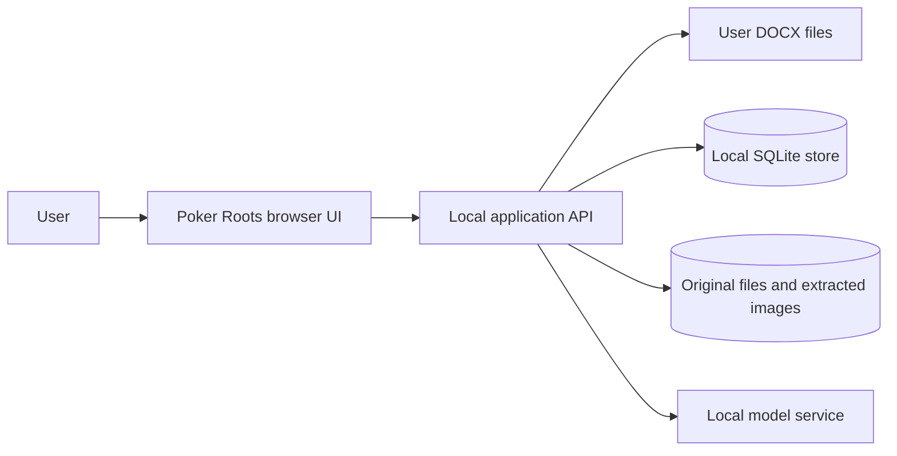

## Title

| Field | Value |
| --- | --- |
| Document | Architecture Design Document — Texas Hold'em Theory Knowledge Tree |
| Initiative | Organize and study Mentopoker theory |
| Version | 0.1 |
| Status | Draft - for review |
| Author | Conditor |
| Reviewers | Project owner |
| Organization | Aelium |
| Last Updated | 2026-10-31 |

## 1. Overview

### 1.1 Purpose

Define a feasible first-version architecture for importing Texas Hold'em theory, preserving its provenance, editing a learning graph, and answering questions with locally executed AI grounded in retrieved documents. The existing Poker Roots prototype supplies a visual and interaction starting point; its sample theory is never treated as imported evidence.

### 1.2 Scope

This design covers a single-user local application: browser interface, local API, DOCX extraction and processing, durable records, search index, local model integration, and the learning tree. Packaging for a particular operating system and deployment to other machines are outside the confirmed scope.

The main viewpoints are: user interaction and learning progression; source provenance and data integrity; processing and retrieval; local operation and failure recovery.

## 2. Architectural Principles

- **Source first:** every sourced claim points to a retained document fragment; generated examples carry a separate origin marker.
- **Reviewable AI output:** imported topics begin as proposals the user can inspect and correct. Unsupported fields remain unknown.
- **One topic record, many relations:** placement links and prerequisite links are separate; a topic may appear in several branches without content duplication.
- **Local inference:** generation and semantic representation run through a local model service; application content is not sent to a remote AI endpoint.
- **Recoverable processing:** retain original files and stage results so an extraction, analysis, or indexing failure is visible and retryable.
- **Progressive interface:** preserve the sketch's four illustrated scenes as presentation cues while difficulty and prerequisite order come from persisted topic data.

## 3. System Context

The project owner uses a browser on the same machine as the local application. The application reads user-selected DOCX files and calls a locally running model service. It stores the original files, structured topics, relations, and retrieval data locally. No account system, cloud service, or solver is required by the first-version brief.

### Context Diagram

## 4. High-Level Architecture

### Components

| Component | Description |
| --- | --- |
| Poker Roots UI | Adapt the existing HTML/CSS/JavaScript prototype into data-driven tree, topic reader/editor, import status, and search/study views. Keep its illustrated scenes and responsive layout, but remove sample theory from the live knowledge base. |
| Local API | Expose document import/status, topics, source viewing, classifications, relations, tree, search, and study-path operations to the UI. Validate input and coordinate processing. |
| DOCX extractor | Read document order, paragraphs, tables, and extractable images; preserve their source locations and report elements that cannot be represented faithfully. |
| Topic processor | Use the local model to propose topic boundaries, structured fields, evidence links, classifications, difficulty, and possible prerequisites. Validate structured output and flag unsupported assertions. |
| Knowledge store | Persist documents, source fragments, images, topics, manual revisions, strategic facets, branch links, and prerequisite links. |
| Retrieval index | Index source fragments and current topic text for lexical and semantic retrieval; keep index updates tied to import and edit events. |
| Answer and path service | Retrieve evidence, compose a source-grounded local-model answer, detect material ambiguity or insufficient coverage, and order available topics by prerequisites. |
| Local model adapter | Isolate model calls for topic processing, query interpretation, answer generation, and embeddings behind one interface so the configured local models can change. |

The tree is a **view of a directed acyclic prerequisite graph**, not a single-parent content hierarchy. Separate branch placements support several navigation paths. The model may propose edges, but the API checks existence and cycles before persisting them. Visual scene index is derived from presentation depth or grouping; it is never stored as difficulty or used to infer a prerequisite.

Core records: `Document` (file hash, path, import state), `Fragment` (document ID, order, location, content type, text/image path), `Topic` (structured content, origin/review state), `TopicEvidence` (topic/claim to fragment), `Facet` (name, value or unknown), `Placement` (topic to branch), `Prerequisite` (from required topic to dependent topic), and `Embedding` (fragment/topic, model version, vector). Exact schema and API contracts remain implementation details governed by these invariants.

## 5. Data Flow

**Import:**

1. The API validates DOCX format, computes a file hash, records an import job, and retains the original.
2. The extractor emits ordered paragraphs, tables, image references, and extraction warnings as source fragments.
3. The processor proposes multiple topics where appropriate. Each proposed claim and condition is linked to supporting fragments; generated examples are marked as generated.
4. Validation checks structured fields, unknowns, evidence links, duplicate candidates, and prerequisite cycles.
5. The store commits reviewable topics and relations; the retrieval index incorporates source fragments and topic text. The UI displays completion, warnings, or the failed stage.

**Search and study path:**

1. The UI sends an informal question or learning goal to the API.
2. The retrieval service combines lexical matches with local embeddings and strategic facet filters, retaining source-fragment IDs.
3. The answer service checks whether missing context changes the applicable material. It asks for clarification when necessary, or answers with cited sources and related topic/tree links. It states insufficient coverage when evidence is absent.
4. For a learning goal, available topics are filtered and ordered with a topological sort of prerequisites. The result includes the reason for each recommendation.

**Manual correction:**

1. The user edits a topic or relation. The API validates fields and rejects cycles atomically.
2. The store records the current topic and its source provenance; generated text does not overwrite original fragments.
3. Search entries and tree views are refreshed from saved data. A failed index refresh is flagged for retry rather than silently presented as current.

## 6. Technology Stack

| Layer | Technology |
| --- | --- |
| Frontend | The existing static HTML, CSS, and JavaScript prototype, refactored into data-driven modules and accessible view states. No framework is required for the first version. |
| Backend | Python local HTTP API using the standard-library `ThreadingHTTPServer` for the first version. Request validation and persistence are separate modules; a framework can replace this adapter if later needed. |
| Document extraction | Python standard-library ZIP and XML parsers for bounded DOCX package extraction, plus local image storage; retain the original and report elements whose meaning cannot be reconstructed. |
| Storage and retrieval | SQLite for durable relational records and FTS5 lexical search; vectors stored locally and compared for the initial collection size. A larger vector index can be introduced if measured volume requires it. |
| AI layer | Ollama-compatible local model service for text generation and embeddings, accessed through a replaceable adapter. Ollama is software for local AI inference, not a poker modality. Model names and minimum hardware are configuration choices, not established requirements. |
| Infrastructure | One local application process, one local model process, a local data directory, and browser access on loopback. |

These are implementation choices for the new repository. The standard-library API and SQLite store are implemented in WP-001, bounded DOCX extraction runs in the background in WP-002, and WP-003 now provides a local model adapter plus source-linked topic proposals and validation. The model endpoint is unavailable in this environment, so real inference and its semantic quality remain unverified. Retrieval remains planned. The API choice avoids a runtime package dependency in the current environment, where package installation is unavailable, while preserving the replaceable HTTP boundary. Model quality, DOCX fidelity, and retrieval relevance must be validated with representative user documents before treating the design as production-ready.

## 7. Deployment Architecture

The first version runs locally. The API binds to loopback by default and serves the UI. SQLite, original DOCX files, extracted images, and indexes live in an application data directory outside the source tree in normal use. Export/backup and installation packaging need a later decision; persistence across restarts is required now.

### Development

Run the browser UI, Python API, and local model service with a separate development data directory. Test imports with synthetic or user-approved sample DOCX files; do not embed the sketch's sample poker statements as factual fixtures for answers.

### Staging

No separate staging environment is established. A disposable local data directory can be used to validate imports, migration, and restart behavior before using the main library.

### Production

For the initial single-user product, “production” means the user's local installation and durable data directory. Remote hosting, multi-user access, and synchronization are not part of the confirmed design.

## 8. Security Considerations

### Authentication

No account system is required for the confirmed single-user, loopback-only scope. If access beyond loopback is introduced, authentication must be designed before exposure.

### Authorization

The local user can import and edit the library. The API must reject requests for arbitrary filesystem paths; source viewing is limited to stored document IDs and registered assets.

### Data Protection

Keep documents and embeddings local. Validate DOCX MIME/ZIP structure, size, and extraction limits to reduce malformed archive risk; never execute embedded content. Avoid logging full source text or model prompts by default. Preserve original files separately from generated and edited material. Database writes for relations and topic edits are transactional, and indexing failures are reported. Backup and data retention behavior remain to be specified before broader release.

## 9. Architecture Decisions

| ID | Decision | Rationale |
| --- | --- | --- |
| ADR-001 | Adapt the supplied Poker Roots static UI into a data-driven browser frontend. | It already demonstrates the requested descending visual progression and provides reusable assets and interactions. Its hardcoded topics must be replaced by persisted data. |
| ADR-002 | Use a local Python API with separate extraction, processing, storage, retrieval, and model adapters. | The stages have different failure modes and can be validated independently while keeping local inference explicit. |
| ADR-003 | Use SQLite records plus FTS5 and local embeddings for hybrid retrieval. | Supports durable, source-linked data and both technical and everyday queries without a separate server for the first version. |
| ADR-004 | Store prerequisite edges as an acyclic graph and placements as distinct navigation links. | A topic may depend on several concepts and appear in several branches without duplication; difficulty remains independent. |
| ADR-005 | Retain original DOCX files and ordered source fragments with evidence links; mark generated examples separately. | Enables source inspection, correction, and honest answers when evidence is incomplete. |
| ADR-006 | Call a configurable local model service through an adapter. | Meets local inference and RAG requirements without tying stored knowledge to one model version. |
| ADR-007 | Run first-version UI and API on loopback with local durable files. | Fits the confirmed single-user scope and avoids an unrequested remote deployment or account system. |

## 10. Requirements Addressed

| Decision (ADR-xxx) | Requirement(s) satisfied | Notes |
| --- | --- | --- |
| ADR-001 | REQ-005, REQ-006, NFR-003, NFR-004 | Reuses the user-supplied visual prototype without treating sample copy as theory. |
| ADR-002 | REQ-001, REQ-002, REQ-011, NFR-008 | Processing responsibilities and errors remain distinct. |
| ADR-003 | REQ-007, REQ-009, REQ-011, NFR-005 | Hybrid search uses stored evidence and current topic content. |
| ADR-004 | REQ-004, REQ-005, REQ-006, REQ-008, NFR-009 | Graph constraints and branch placement are separate. |
| ADR-005 | REQ-002, REQ-003, REQ-009, REQ-010, NFR-006 | Originals, fragments, and generated examples have different provenance. |
| ADR-006 | REQ-003, REQ-007, REQ-011, NFR-007 | Local model and embeddings are replaceable configuration. |
| ADR-007 | REQ-009, REQ-011, NFR-005, NFR-007 | Local scope is an initial design decision, not a claim of multi-user security. |

The design uses the user-supplied prototype at `poker-roots-boceto/poker-roots/` as a visual source. The Specification remains the authority for behavior and acceptance criteria.
